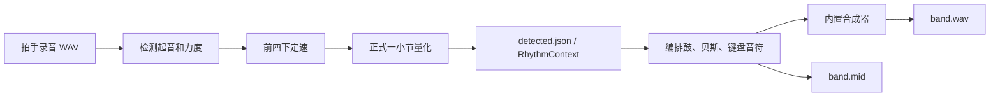

# JamMate：会接你话的 AI 乐队（AIAA 3800 课程项目原型）

对着麦克风拍几下定个速度，再哼一句。AI 乐队会听出你的速度和调，用你那句话的变形接回来（模进、倒影、逆行、错位）。你不出声，它就主动抛一个短动机等你接。也可以随时用文字指挥它："faster"、"更有力"、"停一下"、"your turn"。每个决定都附一句理由，告诉你它为什么这么做。

可信度评估、设计取舍、研究问题和下一步见 [docs/PLAN.md](docs/PLAN.md)。

## 环境

- Windows 10/11，Python 3.11（已在 conda 环境 `jammate` 中验证）。
- 以下命令在项目根目录执行；路径含空格时用引号包住。

```bat
conda create -n jammate python=3.11 -y
conda activate jammate
pip install -r requirements.txt
pip install -e .
```

## 运行

```bat
python -m jammate demo-input --out demo_out\demo_hum.wav        :: 合成一段 4 下拍手 + E 大调哼唱
python -m jammate offline demo_out\demo_hum.wav --out demo_out\jam.wav --midi demo_out\jam.mid --log demo_out\session.jsonl
python -m jammate offline 你的录音.wav --tempo 90                  :: 没有拍手定速时，用 --tempo 指定
python -m jammate live --tempo 96 --log demo_out\live.jsonl        :: 实时模式，必须戴耳机
```

离线模式的输出：

- `jam.wav`：你的录音和乐队的混音；
- `jam.mid`：乐队的多轨 MIDI，可以导入 DAW 换音色；
- `session.jsonl`：分析结果，以及每个决定和它的理由。

同一个 `--seed` 每次跑出的结果完全一样。

## 节奏驱动伴奏（更新于 2026-10-23）

现在可以直接把一小节节奏交给生成器，生成鼓、贝斯、键盘三个声部。当前范围是 **4/4、一小节循环、16 分音符网格**。`follow` 保留输入位置，`vary` 保留位置并加入少量装饰，`simplify` 保留最多两个相隔至少一拍的主要重音。`energy` 控制力度和变化模式的装饰数量；0 为只有铺底的 break，不改变 BPM。

当前输入理解使用 **librosa 起音检测和信号处理算法**，伴奏使用 **规则编排与内置合成器**；尚未接入 MRT2。建议依次验证：文件输入 → 节奏识别 → 音符生成 → 声音合成，最后再接真实麦克风和实时调度。



其中 JSON 是识别结果，WAV/MIDI 是根据识别结果生成的音乐。**WAV 和 MIDI 从同一组音符分别生成；当前程序没有先写 MIDI 文件再把它转成 WAV。**

在项目目录、已激活的 `jammate` 环境中运行：

```bat
python -m jammate rhythm examples\rhythm_a.json --mode follow --bars 4 --out demo_out\rhythm\follow.wav --midi demo_out\rhythm\follow.mid
python -m jammate rhythm examples\rhythm_a.json --mode vary --out demo_out\rhythm\vary.wav
python -m jammate rhythm examples\rhythm_a.json --mode simplify --out demo_out\rhythm\simplify.wav
python examples\rhythm_demo.py
```

最后一条命令生成 A/B 两种同为 100 BPM 的节奏、每种三种模式的 WAV/MIDI，以及模拟拍手录音。`demo_out/rhythm/report.json` 会重新读取导出的 MIDI，检查输入节奏是否保留、A/B 是否不同、简化和变化是否改变密度，并核对拍手录音的提取结果。原有哼唱演示文件不受影响。

### 四下定速与正式节奏分别做什么

前四下回答“**一拍有多长**”；后面一小节回答“**在这个拍速下，具体在哪些位置敲击**”。如果每隔 0.6 秒拍一次，速度就是 100 BPM，一小节为 2.4 秒。第四下之后再过一拍就是正式小节的第 0 拍，两段之间不另加停顿。

正式小节可以按下面的方式表演：

| 数拍位置 | 第 1 拍 | 第 2 拍 | 第 2 拍后半拍 | 第 3 拍 | 第 4 拍 |
|---|---|---|---|---|---|
| 动作 | 拍 | 拍 | 拍 | 空 | 拍 |
| 程序中的位置 | 0 | 1 | 1.5 | 2 | 3 |

识别出的敲击位置应为 `[0, 1, 1.5, 3]`。相邻敲击间隔可以不同，底下的拍速仍保持不变。相比均匀的 `[0, 1, 2, 3]`，这会让生成的伴奏在第二拍附近更密，在第三拍没有新的敲击；`vary` 模式可能用装饰填入部分空隙。

当前拍手输入记录“何时敲击、相对力度”，不直接识别“一个音持续多久”；音符持续时间由编排规则决定。离线模式只使用定速之后的第一小节，并重复其节奏骨架，后续继续拍出的新节奏不会逐段跟随。正式小节中渐快/渐慢也不会自动改变 BPM。

### 自动定速的计算与严格程度

实现见 [`analysis/tempo.py`](src/jammate/analysis/tempo.py) 的 `tempo_from_onsets()` 和 [`analysis/rhythm.py`](src/jammate/analysis/rhythm.py) 的 `analyze_rhythm_audio()`。

1. 检测起音并筛掉过弱的候选，默认取前 **4 个检测点**，不是人工保证的四次真实拍手。
2. 计算相邻时间间隔；小于 **0.15 秒**的间隔按可能的重复检测排除，至少保留两个间隔。
3. 计算波动系数 `CV = 间隔标准差 / 间隔平均值`。`CV <= 0.20` 通过，超过则停止自动定速。这里是整体波动，不是逐个间隔都允许上下 20% 的误差。
4. 通过后计算 `BPM = 60 / 间隔中位数`，必要时乘以或除以 2，折入 **60–180 BPM**。因此可能存在半速/倍速歧义。
5. 以第四个检测点之后一拍的位置作为正式小节起点。

| 三个检测间隔 | CV 约值 | 判断 |
|---|---|---|
| 0.60、0.60、0.60 秒 | 0 | 通过，100 BPM |
| 0.50、0.60、0.70 秒 | 0.136 | 通过，100 BPM |
| 0.60、0.60、1.20 秒 | 0.354 | 不通过 |

例如一次实录检测间隔为 `1.242、0.650、0.627 秒`，CV 约 `0.339`，会被拒绝。第一个间隔接近后两者的两倍，可能是漏检、误检或实际停顿，不能仅凭该报错认定用户拍得不准。四个点只有三个间隔，一次漏检就可能明显影响判断。

起音提取会根据候选后约 60 ms 的局部峰值筛选，阈值为归一化波形幅度 `max(0.01, 整段峰值 * 0.12)`；拍手过轻或录音含很强的杂音都可能影响检测。应先回听原音频，再判断检测与实际敲击是否一致。

定速的 `CV <= 0.20` 和正式节奏的 `confidence >= 0.65` 是两道不同检查。后者当前按量化误差计算：`confidence = 1 - 平均拍点量化误差 / 0.25`（空节奏为 0）；它衡量网格贴合程度，不是识别正确概率。

### 从拍手录音生成

先均匀拍 4 下定速，第 5 拍开始表演一小节节奏；录到该小节完整结束，包含句末休止。生成的 WAV/MIDI 是独立伴奏，起点为 0，不包含原录音和定速拍手。

#### 已经录好自己的音频：按此顺序操作

以下假设录音是项目目录下的 `headset_rhythm.wav`；如果文件名是 `my_rhythm.wav` 或其他名称，替换命令中的输入路径即可。当前识别为 librosa 起音检测加信号处理，伴奏为规则生成。

1. 打开 Anaconda Prompt，进入项目环境和目录：

   ```bat
   conda activate jammate
   cd /d "D:\桌面\aiaa3800-jammate"
   ```

2. 先播放原始录音，确认拍手清楚、没有其他音乐混入：

   ```bat
   start "" "headset_rhythm.wav"
   ```

3. 如果录制方式是“4 下均匀定速拍手，紧接着一小节节奏”，执行：

   ```bat
   python -m jammate rhythm-audio headset_rhythm.wav --mode follow --bars 4 --out demo_out\my_trial\band.wav --midi demo_out\my_trial\band.mid --rhythm-out demo_out\my_trial\detected.json --log demo_out\my_trial\session.jsonl
   ```

   `my_rhythm.wav` 与 `headset_rhythm.wav` 做对照时，分别使用不同输出目录，例如 `demo_out\computer_trial` 和 `demo_out\headset_trial`，保留两次结果。重复使用同一输出路径会覆盖 WAV/MIDI/JSON，日志则追加。

4. 先看识别结果，再听生成伴奏：

   ```bat
   notepad demo_out\my_trial\detected.json
   start "" "demo_out\my_trial\band.wav"
   ```

   | 输出 | 含义 / 核对内容 |
   |---|---|
   | `detected.json` | 识别结果：BPM、输入小节起点、敲击位置和相对力度 |
   | `band.wav` | 根据识别结果生成的鼓、贝斯、键盘伴奏，不含原录音 |
   | `band.mid` | 三个声部的音符事件，可导入 DAW 查看和换音色 |
   | `session.jsonl` | 本次使用的输入路径、节奏、模式、参数和音符数 |

   例如你在第 1 拍、第 2 拍、第 2 拍后半拍、第 4 拍敲击，预期 `onset_beats` 接近 `[0, 1, 1.5, 3]`（程序从 0 计拍）。先核对拍手数量、位置、BPM 和强弱是否符合录音。`confidence` 是网格贴合程度等启发式分数，不代表预测正确概率，也不等于识别准确率。

5. 识别结果合理后，用同一 JSON 比较生成策略：

   ```bat
   python -m jammate rhythm demo_out\my_trial\detected.json --mode vary --bars 4 --out demo_out\my_trial\vary.wav
   python -m jammate rhythm demo_out\my_trial\detected.json --mode simplify --bars 4 --out demo_out\my_trial\simplify.wav
   ```

   这样固定识别结果，只比较生成的不同：跟随保留位置，变化加装饰，简化减少主要敲击数量。

如果没有录前四下定速拍手，必须已知录制时的 BPM，再用 `--count-in 0 --tempo 实际BPM`。`--origin` 是目标小节在原录音中开始的秒数；只有该小节确实从录音第 0 秒开始时才设为 0。省略时以首次检测到的敲击为第 0 拍，不能保留其前面的休止。

常见报错处理：

| 提示 | 下一步 |
|---|---|
| `not enough count-in claps` | 检查前四下是否清楚、是否漏拍；无定速拍手时使用已知 BPM 的路径 |
| `count-in is not steady` | 检查前四下是否均匀，或是否混入杂音/说话；确认后重新录制 |
| `complete rhythm bar` | 录音没有覆盖目标小节完整时长，需保留句末休止，或核对小节起点 |
| `rhythm is empty or uncertain` | 检查目标小节是否确有清晰敲击、网格位置是否稳定 |

命令失败时可能不会生成新的结果；查看文件修改时间，避免把旧输出当成本次识别结果。

#### 录音设备确认

戴耳机不保证录音输入自动切换到耳机麦克风。在 `jammate` 环境中查看：

```bat
python -m sounddevice
python -c "import sounddevice as sd; print(sd.query_devices(kind='input'))"
```

未传 `device=` 的 `sd.rec(...)` 使用默认输入。插拔有线/USB 耳机、连接蓝牙耳机后应重新检查设备编号；有线耳机的麦克风也可能仍显示为 Realtek。先在 Windows 声音设置的“输入”处通过音量条确认，录制后先回听原音频。

耳机输出和麦克风输入分别选择：无麦克风的耳机只改变播放；带麦克风的耳机还需要电脑接口支持耳麦输入。USB 耳机可能显示为新的输入设备。设备编号只对本次枚举有效，不应长期写死某个编号。

使用默认输入录制 10 秒：

```bat
python -c "import sounddevice as sd,soundfile as sf; sr=int(sd.query_devices(kind='input')['default_samplerate']); print(sd.query_devices(kind='input')['name']); print('Recording 10 seconds...'); x=sd.rec(10*sr,samplerate=sr,channels=1,dtype='float32'); sd.wait(); sf.write('my_rhythm.wav',x,sr); print('Saved my_rhythm.wav')"
```

或先列设备，再交互输入想使用的输入设备编号：

```bat
python -c "import sounddevice as sd,soundfile as sf; print(sd.query_devices()); d=int(input('Input device ID: ')); info=sd.query_devices(d,'input'); sr=int(info['default_samplerate']); print(info['name']); print('Recording 10 seconds...'); x=sd.rec(10*sr,samplerate=sr,channels=1,dtype='float32',device=d); sd.wait(); sf.write('headset_rhythm.wav',x,sr); print('Saved headset_rhythm.wav')"
```

两条命令均会覆盖同名录音，需保留多次对照时先改文件名。均匀定速后只表演一小节，保留句末休止；若使用节拍提示，通过耳机听，避免提示音混入麦克风。个人录音保留本地，仓库中的合成示例可用于共享调试。

#### 其他命令示例

```bat
python -m jammate rhythm-audio demo_out\rhythm\claps_a.wav --out demo_out\rhythm\from_audio.wav --midi demo_out\rhythm\from_audio.mid --rhythm-out demo_out\rhythm\detected.json --log demo_out\rhythm\audio.jsonl
python -m jammate rhythm-audio 你的节奏.wav --count-in 0 --tempo 100 --origin 0 --out demo_out\rhythm\your_jam.wav
```

无定速拍手时必须指定 `--tempo`。`--origin` 是录音中这一小节第 0 拍的秒数；省略时以第一次敲击为第 0 拍，因此要保留开头休止时应明确指定。复杂节奏本身不会被拿来按相邻间隔中位数估速。静音、过短录音和低置信度节奏会报出可读错误。

### 可复现的标准调试音频

先生成一个已知答案的输入，再把它交给识别器，方便区分文件流水线问题和录音设备问题：

```bat
python examples\make_debug_input.py
python -m jammate rhythm-audio demo_out\debug_rhythm\input_claps_100bpm.wav --mode follow --bars 4 --out demo_out\debug_rhythm\band.wav --midi demo_out\debug_rhythm\band.mid --rhythm-out demo_out\debug_rhythm\detected.json --log demo_out\debug_rhythm\session.jsonl
```

[`make_debug_input.py`](examples/make_debug_input.py) 用固定随机种子合成 6 秒、44.1 kHz 的拍手 WAV，并写出独立的 `expected.json`：

| 时间 | 预期内容 |
|---|---|
| 0–0.6 秒 | 安静 |
| 0.6、1.2、1.8、2.4 秒 | 四下均匀定速拍手，100 BPM |
| 3.0、3.6、3.9、4.8 秒 | 正式节奏，拍点 `[0, 1, 1.5, 3]`，相对力度 `[1, 0.55, 0.8, 1]` |
| 5.4 秒 | 正式小节结束 |
| 5.4–6 秒 | 安静 |

源文件的标准答案与识别结果分开保存。分析窗和起音回溯会造成小幅时间/BPM 偏差，不能要求测量值逐位相等。现有 Windows 环境曾测得约 `99.384 BPM`，节奏位置全部恢复，置信度约 `0.942`。这只说明合成文件路径通过，不代表真人拍手准确率或真实声卡延迟通过。

先直接读取合成 WAV 调试；之后播放它并用麦克风重录做对照，可以进一步定位录音环节的影响。生成文件保存在已忽略的 `demo_out/`，新 checkout 通过上述脚本重建。

### 从 detected.json 到 band.wav：编排与合成

入口是 [`pipeline_rhythm.py`](src/jammate/pipeline_rhythm.py) 的 `jam_rhythm()`：读取 `RhythmContext`，检查非空且置信度不低于 0.65，建立 `JamState`，逐小节生成 `Note`，再合成波形并保存。`rhythm` 命令直接读取 JSON，`rhythm-audio` 命令先分析录音，两者复用同一个生成入口。

| 输入字段 | 影响 |
|---|---|
| `tempo_bpm` | 每拍秒数和整体播放速度 |
| `onset_beats` | 各声部触发音符的位置；模式可保留、增添或删减位置 |
| `accents` | 各次敲击映射到音符的演奏力度 |
| `confidence` | 接受/拒绝输入，不作为混音音量 |
| `beat_origin_s` | 原录音时间轴的来源信息；独立伴奏默认从输出第 0 秒开始 |

JSON 不含乐器种类、音高或和弦信息。当前 `jam_rhythm()` 默认使用 `JamState` 的 C 大调、`C → G → Am → F` 四小节和弦循环，参见 [`generate/harmony.py`](src/jammate/generate/harmony.py)。拍手本身没有被用来推断这些和弦。

[`generate/arranger.py`](src/jammate/generate/arranger.py) 为每小节选和弦，将节奏交给 [`generate/rhythm.py`](src/jammate/generate/rhythm.py) 的 `rhythm_parts()`。以 `[0, 1, 1.5, 3]`、跟随模式、默认能量 2 为例，第一小节为：

| 拍点 | 鼓 | 贝斯 | 键盘 |
|---|---|---|---|
| 0 | 底鼓 + 闭镲 | C | C、E、G 和弦 |
| 1 | 军鼓 + 闭镲 | G | C、E、G 和弦 |
| 1.5 | 底鼓 + 闭镲 | C | C、E、G 和弦 |
| 3 | 军鼓 + 闭镲 | G | C、E、G 和弦 |

当前三个声部共用同一组敲击位置，底鼓/军鼓及贝斯根音/五度按敲击序号交替；后续小节按和弦换音高。节奏变稀或变密也会影响该交替分配。贝斯音长为“到下一次敲击的间隔”和 0.75 拍中的较小值，键盘最长 0.5 拍。`energy=0` 时直接生成整小节铺底。

中间的 `Note` 是结构化事件，不是音频采样：

```python
Note(pitch=36, start=0.0, duration=0.75, velocity=85, instrument="bass")
```

它表示贝斯在第 0 拍触发一个 MIDI 音高为 36 的音，持续 0.75 拍、力度 85。编排使用“拍”为单位；第二小节起点统一加 4 拍，第三小节加 8 拍。第一击相对力度为 1、默认能量为 2 时会得到上述力度值。

[`render/synth.py`](src/jammate/render/synth.py) 的 `render()` 完成声音合成：

1. 用 `时间（秒）= 拍数 × 60 / BPM` 确定每个音符位置，再换算为采样点。
2. 根据 `instrument` 和 `pitch` 选择波形/频率：鼓使用短促振荡或噪声，贝斯与键盘使用不同的谐波和音量包络。
3. 用 `声部增益 × velocity / 127` 调整振幅，将所有声音叠加。
4. 整体峰值超过 0.98 时等比例缩小，生成单声道波形；CLI 用 `soundfile.write()` 写入 WAV。独立路径保留完整小节时长，再加 1.5 秒尾音空间。

原始拍手声不混入这条路径的 `band.wav`。当前内置音色是原型用的简易合成音色，没有使用真实乐器采样库。

### 乐器、音量和音色如何调整

| 调整目标 | 修改位置 / 方式 |
|---|---|
| 保留节奏、增加装饰或简化 | CLI 的 `--mode follow/vary/simplify` |
| 整体演奏力度和装饰密度 | CLI 的 `--energy 0/1/2/3`；0 为铺底，BPM 不变 |
| 生成多少小节 | CLI 的 `--bars` |
| 鼓、贝斯、键盘分别弹什么、什么时候弹 | `generate/rhythm.py` 的 `rhythm_parts()` |
| 各声部相对混音音量 | `render/synth.py` 的 `_GAINS` |
| 只保留某些声部 | 在 `jam_rhythm()` 编排后、`render()` 前筛选 `notes` |
| 和弦循环 | `generate/harmony.py` 的 `PROGRESSIONS`；调性默认值在 `state.py` |
| 内置 WAV 的乐器音色 | `render/synth.py` 的 `_bass()`、`_keys()`、`_DRUMS`、`_voice()` |
| 导出 MIDI 的乐器编号 | `render/midi_out.py` 的 `_PROGRAMS`，或在 DAW 中指定音源 |

例如把 `_GAINS` 改成下面的相对比例，再重新生成 WAV：

```python
_GAINS = {"drums": 0.45, "bass": 0.60, "keys": 0.12, "lead": 0.32, "user": 0.30}
```

如果需要仅输出鼓，在 `jam_rhythm()` 得到 `notes` 后增加：

```python
notes = tuple(n for n in notes if n.instrument == "drums")
```

这样 `RhythmResult.notes` 和生成的音频都只含鼓，导出的 MIDI 也相应变化。调试某个声部时可用相同方式选择 `bass` 或 `keys`。

**当前 CLI 没有单独选择乐器或设置各轨音量的参数。** `--energy` 不是独立混音推子。`_PROGRAMS` 仅影响 MIDI 的乐器编号，改它不会改变内置合成器生成的 WAV。仅把 `instrument` 名称改成 `guitar` 也不会自动产生吉他音色，需实现对应渲染器或接入音源。提高音色质量可以导出 `band.mid`，在 DAW 中给三个轨道分别选择音源，再导出音频；SoundFont/MRT2 尚未接入当前 WAV 路径。

### 按代码追踪整条流水线

| 顺序 | 文件与函数 | 重点 |
|---|---|---|
| 1 | [`cli.py`](src/jammate/cli.py) / `_cmd_rhythm()` | 文件读取、命令参数、各输出路径 |
| 2 | [`analysis/rhythm.py`](src/jammate/analysis/rhythm.py) / `analyze_rhythm_audio()` | 起音、定速、正式小节、量化与力度 |
| 3 | [`rhythm.py`](src/jammate/rhythm.py) / `RhythmContext` | 输入校验、JSON 接口与 Python 数值类型 |
| 4 | [`pipeline_rhythm.py`](src/jammate/pipeline_rhythm.py) / `jam_rhythm()` | 构造状态、按小节编排、生成完整波形 |
| 5 | [`generate/arranger.py`](src/jammate/generate/arranger.py) / `arrange_bar()` | 当前和弦、声部集合、绝对拍点 |
| 6 | [`generate/rhythm.py`](src/jammate/generate/rhythm.py) / `rhythm_parts()` | 三种模式及各声部的音高、音长、力度 |
| 7 | [`render/synth.py`](src/jammate/render/synth.py) / `render()` | 音符转采样、音色、混音、限幅 |
| 8 | [`live.py`](src/jammate/live.py) | 完整小节捕获、事件传递、下一未渲染小节生效 |

### 接口与实时联调

`examples/rhythm_a.json` 是输入组可直接使用的接口样例：

```json
{
  "tempo_bpm": 100,
  "beat_origin_s": 0,
  "beats_per_bar": 4,
  "onset_beats": [0, 1, 1.5, 3],
  "accents": [1, 0.5, 0.8, 1],
  "confidence": 1
}
```

敲击位置按拍计，必须递增、无重复且位于 `[0, 4)`；力度位于 `(0, 1]`，休止用缺少敲击表示。`beat_origin_s` 属于输入音频时间轴。生成独立伴奏时不会自动加上这段静音，也不会据此重启正在播放的乐队。共享状态中的 `tempo_bpm` 是实际播放速度，节奏对象中的 BPM 保留输入分析时的速度。

Python 接入：

```python
from jammate.rhythm import load_rhythm, RhythmMode
from jammate.pipeline_rhythm import jam_rhythm
from jammate.director.policy import UserRhythm

context = load_rhythm("examples/rhythm_a.json")
result = jam_rhythm(context, bars=4, mode=RhythmMode.FOLLOW)
# 已有 LiveJam 实例时，在工作线程调用：
# live_jam.apply(UserRhythm(context, mode=RhythmMode.VARY))
```

戴耳机运行麦克风节奏模式，跟着当前伴奏拍一小节节奏：

```bat
python -m jammate live --tempo 100 --input-mode rhythm --log demo_out\rhythm\live.jsonl
python -m jammate live --rhythm examples\rhythm_a.json --input-mode rhythm --rhythm-mode vary
```

实时控制台支持 `follow rhythm` / `跟随节奏`、`vary rhythm` / `变化节奏`、`simplify` / `简化`，以及原有的 `faster`、`slower`、`更有力`、`停一下`。输入 `rhythm examples\rhythm_b.json` 可在运行中换节奏。启动时传入 `--rhythm`，文件中的 BPM 优先于 `--tempo`。

麦克风模式按现有播放网格收集完整小节，分析后交给下一尚未渲染的小节。它不会从切分拍手自动推断新速度；变速通过命令或上游 `UserRhythm` 事件提供。已有节奏后，上游每次速度更新最多改变 8 BPM；置信度低于 0.65 或空输入保留当前伴奏。`confidence` 来自网格贴合度等启发式判断，尚未经过真人/噪声数据校准。

调度使用共享采样时钟，丢音频块时放弃该不完整小节，渲染落后时跳过完整小节保留拍点相位。`rhythm_input`、`decision`、`bar_scheduled`、`bar_playback` 日志记录输入小节、预计生效位置、实际安排的小节和设备提供的 DAC 时间；时戳包含微秒和单调时钟。多个更新可能覆盖同一个尚未渲染的小节，以 `bar_scheduled` 为准。`bar_playback` 是设备时间报告，不能直接当作扬声器实际发声的测量值。真实声卡延迟、回授和真人拍手准确率仍需戴耳机实测。

## 测试

```bat
python -m pytest --cov=jammate --cov-report=term-missing
```

`live.py` 不计入总覆盖率；调度、节奏更新、输入/输出时间映射和完整小节收集已有无声卡测试。真实设备仍按下面清单手动验证。

### 实时模式手动验证清单

1. 戴上耳机，运行 `python -m jammate live`，能听到鼓、贝斯、键盘的循环（C 大调，96 BPM）。
2. 哼一句 2–4 秒的旋律，停下来。约一小节后，听到合成主音在用你的句子回应；控制台打出 `[follow] ...`。
3. 输入 `faster`：下一小节起速度变快。输入 `停一下`：只剩铺底。输入 `更有力`：鼓点变密。
4. 什么都不做，等两小节：AI 会主动抛一个动机（控制台打出 `[initiate] ...`）。
5. 输入 `q` 退出。`--log` 指定的 JSONL 里应该有 phrase、command、decision 三类记录。
6. 改用 `--input-mode rhythm --tempo 100`，跟拍一小节，再换一个相同速度的节奏；确认鼓、贝斯、键盘在后续完整小节更新。
7. 输入 `简化`、`变化节奏`、`faster`，分别确认密度/装饰和速度改变；停止拍手时应保留当前节奏。
8. 检查 `rhythm_input`、`bar_scheduled`、`bar_playback`，并用回录测实际延迟；不能仅凭单元测试认定现场播放通过。

## 代码结构

| 模块 | 职责 |
|---|---|
| `analysis/` | 拍手 → 速度，哼唱 → 音符，音符 → 调，麦克风流 → 乐句起止 |
| `director/` | 文字和手势 → 意图（Intent）；`policy.decide(state, event)` 返回决定和理由 |
| `generate/` | 和弦循环、三档能量的伴奏型、动机回应与主动抛出、逐小节编排 |
| `rhythm.py` / `pipeline_rhythm.py` | 节奏接口校验、三种节奏生成模式的离线闭环 |
| `analysis/rhythm*.py` / `render/clock.py` | 拍手节奏提取、完整小节收集、共享采样时钟 |
| `render/` | numpy 合成器、MIDI 导出、实时重叠相加缓冲 |
| `pipeline.py` / `live.py` | 离线（可复现）和实时两种运行方式 |
| `session_log.py` | 用户研究用的 JSONL 日志 |
