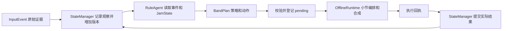

# Agent v1：从 InputEvent 到多轮伴奏

日期：2026-10-31。本文记录 **规则 Agent 基线、公共状态/计划与离线执行约定**。后续已接入默认 LLM 决策，最新入口与真实 API 验证见 [LLM_AGENT.md](LLM_AGENT.md)；下面用 --agent rule 重现原基线。真实录音活动检测和新版 Renderer 实时播放仍未集成。

## 1. 先运行，再看每一步

在项目根目录、已安装依赖的 `jammate` 环境执行：

```bat
python examples/agent_demo.py --agent rule
```

输出目录是 `demo_out/agent_v1/<本次时间>/`。每次新建目录，避免覆盖先前证据。

| 文件 | 看什么 |
|---|---|
| `band.wav` | 八轮连贯的离线合成试听，包含各轮尾音 |
| `band.mid` | 固定速度时的全段多轨 MIDI，可在 DAW 换音色 |
| `report.json` | 每轮 strategy、action、音符数、状态版本、未理解要求 |
| `trace.jsonl` | 输入 → 观察状态 → 计划 → 执行回执 → 提交状态的关联 |
| `state_initial.json` / `state_final.json` | 完整会话状态快照 |
| `turn_02/input_01.json` | “这个不错，鼓再猛一点”的原始事件 |
| `turn_02/state_observed.json` | Agent 看到的状态：新反馈已记录，鼓尚未增强 |
| `turn_02/plan.json` | FOLLOW + PRESERVE + BUILD/drums，以及保留约束 |
| `turn_02/state_applied.json` | 合成成功回执后，鼓的 level 更新 |
| `turn_02/band.wav` / `.mid` | 单独检查本轮执行结果 |

建议先比较第二轮的 `state_observed.json → plan.json → state_applied.json`，再听第三轮 SIMPLIFY。JSON 中的 `motifs` 是可复用乐句记忆，不能等同于当前小节正在持续播放的音轨。

也可以用自己的 InputEvent 文件按轮执行：

```bat
python -m jammate.contracts text "这个不错，鼓再猛一点" --session-id jam_demo --out demo_out/build_event.json
python examples/agent_demo.py --agent rule --batch examples/input_events/rhythm.json examples/input_events/humming.json --batch demo_out/build_event.json
```

一次 `--batch` 中的文件明确属于同一轮；再写一个 `--batch` 就是下一轮。所有事件必须使用同一个 session_id。默认演示使用 100 BPM、C major，这是会话初始化配置，**不是从这份哼唱推断出的速度和调性**。

允许 `--bpm 96`、`--seed 3800`、`--out <新目录>`。若多轮中实际变速，只输出逐轮 MIDI，省略全段 `band.mid`；WAV 按每轮自己的速度拼接。当前没有通用 tempo-map MIDI 导出。

## 2. 公共链路和职责



Agent **不直接生成 MIDI 音符，也不直接修改共享状态**。它保留自然语言原文，结合当前状态选择策略和动作。StateManager 是新路径的唯一写入入口；Renderer 执行动作并返回结果。旧 `director/policy.py`、`live` 等入口保留作兼容演示，目前还没有切到新 StateManager。

| 边界 | 实现/可共享定义 |
|---|---|
| InputEvent 1.0/1.1 | [输入契约](INPUT_EVENT_V1.md)、[schema](../src/jammate/contracts/input_event.schema.json) |
| JamState 1.0 | [现有 state.py 的升级](../src/jammate/state.py)、[schema](../src/jammate/contracts/jam_state.schema.json) |
| BandPlan 1.0 | [不可变计划与校验](../src/jammate/contracts/band_plan.py)、[schema](../src/jammate/contracts/band_plan.schema.json) |
| 状态管理 | [manager.py](../src/jammate/orchestration/manager.py) |
| 规则决策 | [agent.py](../src/jammate/orchestration/agent.py) |
| 执行参考 | [offline.py](../src/jammate/orchestration/offline.py) |

这些是仓库已实现的接收基线，仍需与组员确认后用于共同交接，不表示全组已经批准全部扩展字段。

## 3. JamState：一份状态的结构化 JSON 视图

沿用原 `JamState`，保留旧 Python 字段/调用方式；`to_dict()` 提供分组后的公共 JSON，`from_dict()` 校验并恢复同一对象，不新增另一份可独立修改的状态。

| 分组 | 内容与单位 |
|---|---|
| 根字段 | schema_version、session_id、state_version |
| transport | tempo_bpm、playing；bar/next_bar 从 0 开始，beat 为 `[0,4)` |
| harmony | key `{tonic:0..11, mode:major/minor}` 或 null；progression_variant |
| form | section、bars_elapsed |
| feel | energy `0..3`；density/brightness/tension `0..1`；tags |
| motifs | current_id、items；每句的 owner=user/ai、来源事件和拍坐标音符；last_user/last_ai |
| arrangement | drums/bass/keys/lead 四层，active、level、density、role |
| interaction | strategy、initiative、current_lead、user_active、awaiting_user、last_feedback |
| rhythm / rhythm_sources | 当前已采用的节奏，以及尚可选择的输入节奏记录 |

哼唱到来后先注册用户 motif，节奏到来后先注册 rhythm source；成功执行 ECHO/ADJUST_FEEL 后才更新“当前已采用”的内容。输入的未知 key 保留为 null；离线和声执行器遇到未配置的 key 会明确失败，不偷填调性。

首版实际控制密度/力度使用 `arrangement.layers`。全局 density、brightness、tension、tags 是预留描述字段，当前规则不修改它们；brightness 动作会被执行能力校验拒绝，不能把写入字段当作完成音色变化。SIMPLIFY 只减伴奏密度，完整主旋律音符保留。

## 4. BandPlan：可检查的决策，不装新音符

每个计划包含：

- `plan_id / session_id / based_on_state_version / trigger_event_ids`：明确基于哪个会话、状态和输入。
- `strategy`：LISTEN、FOLLOW、RESPOND、INITIATE。
- `effective_at: {bar, beat}` 与 `valid_for_bars`：从哪个位置开始、覆盖多少小节。参考执行器目前只支持下一未渲染小节、beat=0、最多 16 小节。
- `preserve`：tempo、key、playing、groove、`motif:<id>`、`layer:<name>` 等约束。generic PRESERVE 是语义动作，具体不得改什么以这个列表为准。
- `actions`：每项为 action/scope/strength/parameters。motif 和 rhythm 通过 ID 引用状态中的材料，禁止塞入生成音符、GM program、CC 或后端 prompt。
- `transport`：可选的 playing/tempo_bpm 更新；停止/继续属于播放控制，不借用一个新的音乐 Action。
- `plan_confidence=null`：规则没有校准置信度；reason 解释决策，unresolved 列出未理解或冲突要求。

当前语义动作与实际效果：

| 动作 | 执行效果 |
|---|---|
| PRESERVE | 保持当前编排参数；不自动重复播放历史 motif |
| ECHO_MOTIF | 使用登记的音高、拍点、时值和力度；保留前导休止、重叠，不走旧 normalize |
| VARY_MOTIF | 调用旧规则变奏器；允许相对化和改变音高节奏；不能同时要求 preserve motif |
| INTRODUCE_MOTIF | 执行端生成一句，回执登记 ai motif；完成后 LISTEN + awaiting_user |
| BUILD | 指定层 level 增加 `0.5 * strength`，上限 1，按 duration_bars 渐强 |
| SIMPLIFY | 指定伴奏层 density 减少 `0.5 * strength`，下限 0；按起音组删减，和弦同组保留；每小节仅一组时按绝对小节分配休止，避免参数变了却始终保留唯一和弦 |
| ADJUST_FEEL | 使用 rhythm_event_id 切换节奏，或 level_delta 调整层音量；不自动改 BPM |
| ADD_LAYER / REMOVE_LAYER | 指定声部 active 开关 |
| FILL / guitar / brightness | 预留或未支持，明确拒绝执行，不声称已完成 |

本版全部节奏输入都沿用会话 BPM；输入分析的 tempo_source 和 BPM 保留作证据。改变会话速度需要显式“加速/减速”指令（±8 BPM，限制在 60–180）。节奏 confidence≥0.65 且非空才采用；这个门槛只用于规则防抖，不是识别准确率保证。低分/空输入保留原 groove。

ECHO 的 canonical motif 记录完整；实际演奏仍受 lead 的音量设置影响。若 lead 被关闭或静音，参考端拒绝 motif 响应，避免产生“已经回应”的假回执。

## 5. 多轮、并发、版本与回执

1. `manager.ingest(events)` 原子校验一个显式关联批次。接受新输入后版本 +1，记录观察，取消旧 pending 计划。
2. `agent.decide(accepted, manager.state)` 读取同一快照，给出 BandPlan。
3. `manager.stage(plan)` 校验版本、来源批次、保留约束和执行范围，登记 pending；此时乐队效果未发生。
4. `runtime.execute(manager, plan)` 生成音符/音频，再提交回执。成功后正式状态版本 +1；失败不提交计划效果。
5. 重复 event_id + 相同内容无副作用；相同 ID 改内容、跨 session、过期状态计划、错误回执范围都会被拒绝。重复终态回执不会再生效，已消费的批次不能换个 plan_id 重复执行。

诊断迭代补充：失败未消费输入，可通过 `current_batch()` 和新 plan_id 显式重规划；成功后批次才清空。Kevin 使用 `acknowledge_and_snapshot()` 在同一锁内取得提交状态，避免新输入到达后回执误写成更晚的版本。日志写入错误通过 `diagnostics()` 暴露，不能把“流程继续”理解为已经持久化。最新证据见 [多轮诊断](DIAGNOSTIC_ITERATION_20261031.md)。

例如初始 v0，第一轮输入后 v1，执行成功后 v2；第二轮输入 v3，执行后 v4。这不是“每轮只能加 1”。

Runtime 更新精确小节位置时不增加语义版本；一旦错过 effective_at，计划标记 expired。JSONL 会关联 event_id/state_version/plan_id。当前去重、待执行计划和时间水位存在进程内；JSONL 是审计记录，**尚未实现崩溃恢复、跨进程幂等或重启重放**。

已知 ended_at 早于此前接受的最大结束时间时，事件记为 stale，不撤销较新决策。同一显式 batch 内不会相互判旧；未知时间的离线输入按提交顺序处理。这是保守防覆盖规则，可能忽略延迟到达但仍有用的另一模态；自动等待窗口、语义关联、延迟结果补偿仍需下一阶段实现。

回执中的 lead_notes 是本次 canonical 乐句，generated_motif 仅用于 INTRODUCE；乐句时间相对计划起点。参考端还检查 preserve layer/groove 对应的实际音符，不只比较状态字段。

**离线 succeeded 的含义是已在内存生成对应音符/音频。** 它不表示声卡已经播放。实时端需要自己定义调度接受/真实播放/中断回执，再接入同一个 StateManager；不能把本演示的 completed_bar 当成设备时钟。

## 6. 文本和生命周期输入

首版按完整短句匹配，逗号/句号/分号可分句，支持上述示例的中文和部分英文；它是明确的规则基线，不是任意自然语言模型。原文始终留在 InputEvent。

| 输入 | 结果 |
|---|---|
| 这个不错，鼓再猛一点 | FOLLOW + PRESERVE + BUILD/drums，保留其他层 |
| 太满了，留点空间 | 一次 SIMPLIFY/band，不把两个同义短句重复叠加 |
| 别停，鼓收一点，刚才那句保留 | 保持 playing，简化鼓，保留当前 motif |
| 不要停 / don't stop | 不产生 stop |
| 加贝斯 / 去掉贝斯 | ADD_LAYER / REMOVE_LAYER |
| 鼓停止 / 贝斯继续 | 只关闭鼓 / 开启贝斯，不当作整队停止或恢复 |
| 节奏保持，鼓收一点 | 若实际减少了受保护的鼓拍点，执行校验拒绝并返回失败 |
| 鼓更猛，鼓收一点 / 未支持表达 | LISTEN，保持当前编排，在 unresolved 中说明原因 |

`source=system,event_type=session_control` 使用新增 **InputEvent 1.1.0**：

```python
from jammate.contracts.adapters import from_system
activity = from_system("user_activity", session_id="jam_demo", active=True)
idle = from_system("idle", session_id="jam_demo", bars=2)
stop = from_system("stop", session_id="jam_demo")
start = from_system("start", session_id="jam_demo")
```

可共享 JSON 样例：[idle.json](../examples/system_events/idle.json)。这些应来自输入活动检测器/Runtime 的事实，当前 demo 手工模拟。`active=True` 让 Agent LISTEN 并减伴奏；活动结束时需另发 active=False。idle≥2、没有用户在表演、尚未等待用户且播放开启时，AI 才主动一次。执行完成后 awaiting_user=True，重复 idle 不会继续自我续写；真实新输入解除等待。停止优先于其他动作，重新开始需要显式 start/继续。

## 7. 已验证与下一步

2026-10-31 在 Windows conda `jammate` 环境运行：

```bat
python -m pytest -p no:cacheprovider
```

**324 passed，5 个已有依赖/坏音频用例警告**。其中新增 orchestration 测试 47 项，InputEvent 测试 51 项。覆盖往返 JSON、scope/否定、保留真实音符、显式多模态批次、主动后等待、停止/恢复、事件幂等、版本过期、失败/重复回执和日志关联。

八轮离线样例产物位于本机 `demo_out/agent_v1/validated_20261031/`（被 Git 忽略）：总计 29 小节、71.1 秒，MIDI 554 个音符；第三轮从 96 个伴奏音符降到 72 个；第一次 idle 主动，第二次 idle 等待。WAV 使用基础合成音色，合成哼唱样例仍含上游识别出的重叠/八度音，未人工修正后冒充输入质量。

Wyman 下一步按顺序推进：

1. 与 Wenhan 确认 schema/样例，约定真实会话时钟、活动开始/结束和一次输入何时完成；补自动多模态分组。
2. 与 Kevin 对接 `JamState + BandPlan → Renderer` 和执行回执，先用可控 MIDI 后端；仍由 Renderer 管 GM/CC/音色和设备调度。
3. LLM 意图解释、输出修正、超时 fallback 已接入同一 BandPlan 入口，见 [最新实现](LLM_AGENT.md)。继续做独立自然表达评测、异步调度与真实播放验收。
4. 用真人输入逐场景验收。当前合成回归和八轮脚本不等于 SPEC 八场景的完整产品验收，也没有测真实声卡延迟。
