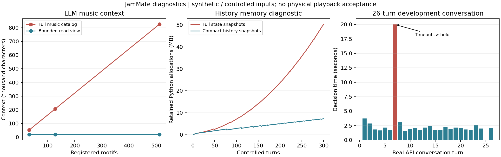

# 诊断迭代：多轮状态、故障恢复与哼唱切分

本轮已修复失败后无法重规划、回执误报、日志故障打断状态、LLM 上下文持续膨胀及历史快照重复保存音乐库的问题。新增故障注入、300 轮受控运行、26 轮真实 API 会话，以及哼唱解码参数对照。项目下一阶段的交付物与验收条件见 [PROJECT_IMPROVEMENT_PLAN.md](PROJECT_IMPROVEMENT_PLAN.md)。



机器摘要：[stability_20261031_summary.json](stability_20261031_summary.json)。完整证据位于本机 `demo_out/stability_20261031/`。原来的 `acceptance_20261031_v1` 批次及失败记录保持不变。

## 1. 定位到的工程问题

| 问题 | 修复前表现 | 当前行为 |
|---|---|---|
| 执行失败后输入被消费 | failed 回执清空 batch；重复发送又被去重，原输入无法重规划 | failed 保留当前 batch；`current_batch()` 返回待完成输入；新 plan_id 可重试，成功才消费 |
| Renderer 忽略回执返回值 | 并发情况下 manager 已将计划标为 failed，ack 返回 False，Renderer 仍报告成功 | Kevin 和参考 Runtime 都检查是否接受回执；终结或过期计划不能冒充新执行成功 |
| 输出目录冲突影响其他执行 | 第二个 exporter 发现目录存在后把共享计划标为 failed | 拒绝覆盖，保留共享计划状态；单 Runtime 实例串行执行 |
| 日志故障打断提交 | 磁盘写满时可能在记录 event、更新 state 或 ack 中途抛错 | 进程内状态流程继续，`diagnostics()` 记录写入失败次数、阶段与 errno |
| 提交后文件写入失败被当成执行失败 | 状态已经应用，却抛出普通执行异常，调用方可能再次尝试同一个变化 | `last_receipt.succeeded` 保持真实提交结果，单独记录 `persistence_warnings`；JSON 采用临时文件原子替换 |
| 提交后新输入抢先更新状态 | 回执再读取 manager.state 时可能拿到后续版本 | `acknowledge_and_snapshot()` 在同一锁内取得本次提交的不可变状态，用它生成回执文件 |
| 只限制六轮历史仍超预算 | 当前 JamState 含全部 motif/rhythm，模型 schema 枚举也持续增长 | 完整状态保留；模型得到有限读取视图，schema 使用同一组可见 ID |
| 请求预算漏掉部分内容 | 只计算 context，未包括 system prompt、schema 和修正消息 | 每次发出请求前计算上述完整内容，修正请求也检查预算 |
| 历史快照重复保存音乐库 | 每轮 before/after 持有含全部乐句的 JamState，累计复制增长快 | 历史保存策略相关的紧凑状态；输入和当前音乐库仍完整保留 |

日志容错是明确的**进程内连续性取舍**，不代表掉电后可恢复：日志不可写时，审计证据可能缺失。成功提交与文件持久化是两个结果。UI/调用方必须展示 `manager_diagnostics` 和 `execution_persistence_warnings`；下一阶段需要数据库事务与恢复协议。

## 2. 多轮上下文怎么维护

完整 `JamState` 仍是唯一音乐状态，没有用 LLM 摘要覆盖它。默认模型读取视图选择最多 12 个 motif、8 个 rhythm，优先级为：

1. 本轮输入对应的材料。
2. 当前活跃的旋律与节奏。
3. 原文明确提到的已有 ID，例如 `m3`。
4. 最近登记的其他材料。

必须保留的当前材料可以超过目标数量，随后由请求预算决定能否发送；不会截掉当前输入的音符。`context_selection` 明示被省略的材料数量。超预算时先删除完整的最旧历史轮；若当前输入本身仍过大，明确 fallback，不能悄悄裁剪用户原文或旋律。当前工程预算是字符数保护，并不是 tokenizer 的精确 token 上限。

模型只可引用本次 schema 中可见的 ID。“最开始那句”若已不在视图、也没有可推断的 ID，需要澄清或重新选取；语义检索完整历史尚未实现。字段裁剪不会改变原始 InputEvent 或共享状态。

这是项目自己的读取策略。OpenAI 官方文档说明，多轮历史、输入、输出及推理 token 都涉及上下文窗口管理；本项目继续自行维护业务状态，不把远端对话历史作为 JamState 的替代物。[Conversation state](https://developers.openai.com/api/docs/guides/conversation-state)

对同一批包含 16 音符乐句的状态测量：

| 登记乐句数 | 修复前 context 字符 | 修复后 context 字符 | 修复后 schema 字符 |
|---:|---:|---:|---:|
| 32 | 52,645 | 20,221 | 5,282 |
| 128 | 207,001 | 20,255 | 5,312 |
| 512 | 825,241 | 20,255 | 5,312 |

活跃旧乐句与原文指定的旧 ID 都有测试；当前输入过大、修正消息超预算也有单独测试。不能由此推断模型一定能正确理解所有历史指代。

## 3. 300 轮受控故障测试

固定同一套注入周期，保留第一次运行及紧凑快照修改后的第二次运行。**Provider 是本地受控响应，真实 API 调用为 0**；运行了计划校验、音符准备和状态回执，没有在这 300 轮中生成 WAV。

| 注入/检查 | 次数或结果 |
|---|---:|
| 重复 InputEvent、重复成功回执 | 每轮，均未重复应用 |
| 模拟导出失败后用原输入、新计划重试 | 42 次通过 |
| 替换计划并拒绝旧回执 | 24 次通过 |
| 连接错误 → hold → 后续继续 | 23 次通过 |
| 非法模型 JSON → 一次修正 | 16 次通过 |
| 迟到事件拒绝 | 15 次通过 |
| 模拟日志写满 | 73 次写入错误被记录，流程继续 |
| 最终状态版本 / 下一小节 | 600 / 300，无倒退 |
| 音乐库 | 保留 100 个登记乐句 |
| 初次模型请求最大字符数 | 64,076，未触发上下文降级 |

同样 300 轮的 `tracemalloc` 保留分配从 **50,317,522 bytes 降至 7,286,018 bytes**。这是 Python 跟踪分配，不是进程 RSS，也不包含全部外部库/声卡内存。两次运行有测量开销和环境负载差异，不把耗时差异当成性能 benchmark。

**内存仍不是恒定的**：原始事件、计划、音乐库及历史条目继续随会话线性增长。完整持久化、历史归档、缓存上限和重启恢复放在下一阶段，不能把 300 轮通过称作无限长会话稳定。

## 4. 26 轮真实 LLM + Kevin 会话

使用预先写好的 [stability_cases.json](../examples/stability_cases.json)，单个 StateManager 连续运行，未在每几轮重置。包含力度/密度、历史撤销、声部恢复、变速、暂停/继续、INITIATE 后等待、用户活动期间不抢奏、原样回应和 system stop。

- 26 轮都完成离线 MIDI / FluidSynth 导出。
- **25/26 符合预期行为**：24 次 LLM 决策、1 次无需网络的 system stop。
- 第 7 轮请求键盘变轻，API 在 20 秒截止时超时。该轮 hold，键盘没有变轻，明确计为未完成；第 8 轮恢复，后续没有把那次未执行调整当成已经完成。
- 成功 LLM 决策耗时 1.594–3.719 秒，中位数 1.992 秒；不包含失败的 20 秒，也不是声卡响应延迟。
- 最大初次请求 34,777 字符。原样回应、主动后等待、用户活动保护和 system stop 均通过。

产物：`demo_out/stability_20261031/llm_26/`，包含逐轮输入、状态、计划、决策记录、回执、MIDI/WAV 与 `evaluation.json`。这是一次开发会话，不能作为任意自然语言、多次随机运行或现场使用的准确率保证。

## 5. 哼唱：2×2 解码参数对照

在上一轮 4 个非静音样例、1 个静音样例之外，加了 2 个对照：5 次明显分开的同音重唱、6 次间隔较短的同音重新起唱。生成后固定哈希，使用相同 Basic Pitch 权重与相同 WAV，仅改变两个解码因素：

| inferOnsets | onsetThreshold | 含静音的通过数 | 非静音的通过数 |
|---|---:|---:|---:|
| 原值 true | 原值 0.25 | 1/7 | 0/6 |
| false | 0.25 | 1/7 | 0/6 |
| true | 0.50 | 6/7 | 5/6 |
| false | 0.50 | 6/7 | 5/6 |

持续音从 18 个碎片变为 1 个音符；两类同音重唱分别保留 5 与 6 个音符。关闭 inferred onset 单独没有改善数量；在这些输入上，onset 阈值是主要影响因素。该因果判断限于这组控制实验。

轻声样例仍把 3 个音符识别成 4 个，precision=0.75：最后一个音多出 onsetActivation≈0.514 的切分，略高于候选阈值 0.5。因此没有继续围绕这一个样例反复调阈值，更没有宣布哼唱已解决。

清洗层原来没有合并，也有代码层原因：要求前一个音至少 0.25 秒，而大多数错误片段只有约 0.12–0.24 秒；后续片段的 onset evidence 也可能超过弱尾音阈值。简单强制拼接会吞掉真实同音重唱。

**组员 handoff 文件没有被修改。** 诊断只在本地 HTTP 服务返回的 bundle 中覆盖参数，报告记录原 bundle、实际 served bundle 和模型权重 SHA256。0.5 是待真人数据确认的候选参数，不是已上线默认值，也不是独立留出评测结果。

## 6. 测试与复现

最终根项目及 Kevin 测试：**407 passed，1 deselected，5 个已有警告**。本轮新增 15 项故障/多轮测试。未选择项仍是需要 Google SDK 的 Lyria backend_input 测试。完整测试时长与 JUnit 元数据见机器摘要；先前 406 项记录另行保留。

在 Windows `jammate` 环境，受控测试不需要 API：

```bat
python -m pytest -p no:cacheprovider tests/test_session_stability.py
python examples/session_stability.py --mode controlled --rounds 300 --out demo_out/stability_new/controlled
```

连续真实服务测试会调用已配置的 OpenAI API：

```bat
python examples/session_stability.py --mode llm --out demo_out/stability_new/llm ^
  --fluidsynth "<FluidSynth程序路径>" --soundfont "<SoundFont路径>"
```

哼唱诊断分三个阶段，`infer` 需要 Playwright/Chromium，另外两步使用 JamMate 的 Python 环境：

```bat
python examples/diagnose_humming.py --stage prepare --batch demo_out/hum_diagnostic_new
python examples/diagnose_humming.py --stage infer --batch demo_out/hum_diagnostic_new --dist "../jammate-hum-stable-handoff-2026-10-24/project/dist"
python examples/diagnose_humming.py --stage evaluate --batch demo_out/hum_diagnostic_new
```

脚本拒绝覆盖已有实验输出。原 300 轮报告和这次历史快照修复前后的对照均保留；绘图脚本为 [summarize_stability.py](../examples/summarize_stability.py)，只读取已有证据，不重新调用模型。
