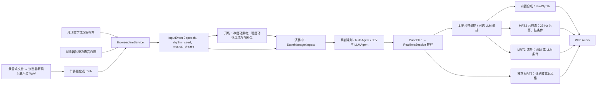

# JamMate 调用链审计

## 修改前基线

本次审计以本地 `integration/mrt2-demo` 的工作树为准。基线 HEAD 为 `6b75ae3`，工作树还包含上一轮尚未提交的实验和运行时修改。GitHub 的 `main` 和 `codex/jammate-workbench` 均为 `94b0073`。审计保留本地实验工作树，远端版本单独核对。模型环境为 macOS 15 arm64、Python 3.12.16、magenta-rt 2.0.3、MLX 0.31.2 和本地 MRT2 Small MLXfn。以下先记录既有代码的实际路径。

| 路径 | 开场及演奏中的状态与计划 | 模型输入与实际声音 |
| --- | --- | --- |
| 规则合成 / FluidSynth | 冷启动以素材、指定拍点和和弦激活声部。暖启动通过 `jam_opening.PROMPT` 与结构化响应填调性、和弦、节奏和目录内声部。演奏中由规则或 LLMAgent 生成 BandPlan，可选第二次 LLM 音符编排 | 本地谱或 LLM 音符交给合成器。FluidSynth 使用配置的 SoundFont。 |
| MRT2 独立流式 | 开场仍共用 MIDI 向的开场逻辑，演奏中通过 `prepare_conditioning` 排程和投影 BandPlan。直接流式不会编译本地伴奏谱 | `band_plan_style` 把文字、JamState 和动作转进 MusicCoCa。每帧只给风格 token，只有 MRT2 PCM 播放。单场会话保留模型状态。 |
| MRT2 音符条件流式 | 共用本地谱或第二次 LLM 音符编排 | 25 Hz 合并音高网格、二值鼓网格和一个风格条件。浏览器只播放 MRT2。 |
| 实时伴奏与 MRT2 试听 | 实时谱先排程，再为指定轮次生成独立试听。按需可另让 LLM 生成条件 | 实时伴奏是合成输出，片段可按小节互斥接管。每次试听独立初始化模型状态。 |
| 文字、语音、拍手与哼唱 | 文字走 `from_text`，语音由浏览器转写后经指令门控。拍手变成节奏网格，哼唱留下音符、时值、来源和置信度相关元数据。结构化输入进入规则或 LLMAgent | 正常 Jam 路径没有把原始哼唱 WAV 交给 MusicCoCa。独立参考实验通过 `embed_style(Waveform)` 更新风格 token，保留原生成 State。 |

## 差异与问题位置

- `jam_opening.py` 的暖启动响应要求非空和弦与鼓点。冷启动对只有「鼓点」的文字只设置时钟，缺少由明确文字授权的独立节奏开场。JamState 的 C 大调及全部核心声部活跃默认值仍有旧入口依赖，应在浏览器开场显式投影，无须全局改默认。
- `llm.py` 的 `decision_schema`、`available_instruments`、`BandPlan` 的 `INTRODUCE_LAYER` 以及合成器执行校验承担精确声部管理。对纯文字 MRT2 也使用这些受限路径时，无法表达更宽的音色与制作要求。
- `mrt2_demo/plan_conditioning.py` 总是拼入时钟、推断的音乐属性和经有限词表预处理的原文。部分中文能进入风格编码，默认属性会改变与原始独立 Prompt 的对照。
- `agent.py` 与 `llm_prompt.md` 会响应显式 Idle Event。浏览器目前没有定期提交 Idle Event。无新事件时的 MIDI pattern 演进、持续 MRT2 模型的自然变化、显式计划及片段接管可分别从小节、事件、条件和播放回执定位。
- `analysis/rhythm.py` 的严格开场要求稳定的四拍定速和完整一小节。演奏中 `analysis/jam_capture.py` 以会话 BPM 和置信门槛分类。约束适用于精确定速与自动分类，显式节奏 Feel 可以复用起音结果，提供独立的宽松入口。

此前使用相同风格 token 的真实 JamMate 开场与独立 MRT2 片段，前 2.5 秒逐样本一致。此前 A–E 的输入和 WAV 保存在 `mrt2_demo/results/renderer-runtime/`。这条同条件对照优先用于隔离多余文字和音符，不将合成器增益、主观音质和模型条件混为一项。

## 修订后的执行边界

| 模式 | 可以控制 | 实际输入与声音 |
| --- | --- | --- |
| MIDI 规则合成 / FluidSynth | 按可用乐器和 SoundFont 精确排程、启停和调整声部。明确的独奏使用单一声部，缺少目标 GM 音色时返回原因 | 已选乐器的音符进入合成器。受限的 Action 和 Scope 校验继续适用 |
| MRT2 独立流式 | 用简短英文风格引导乐器、质感和场景。显式 BPM、调性和节奏按需进入条件。独奏排除其他自动声部 | `BandPlan` 和 `JamState` 直接生成 MusicCoCa 文本 token。启用录音参考时，指定小节改用它的音频风格 token。整个会话只播放 MRT2，声部和力度属于生成式引导 |
| MRT2 音符条件流式 | 受谱面控制，可为乐器音符和鼓点提供引导 | 同一组谱面合并成 25 Hz 音高与鼓条件。声音由 MRT2 生成 |
| MIDI 实时伴奏 + MRT2 片段 | 精确伴奏先播放，MRT2 片段准备好后在调度点接管 | MRT2 若收到编排则从独立模型状态渲染。浏览器按小节互斥切换，试听结束后恢复伴奏 |

- `jam_opening.py` 先处理明确的声部范围，支持纯鼓、单个主奏、明确的完整伴奏和仅音频开场。暖启动编制允许空和弦、空鼓点、未指定调性。独立 MRT2 冷暖启动共用轻量开场，无需调用 MIDI 编制 LLM。一段 MIDI 钢琴旋律如果缺少用户调性，会用内部 C 大调生成首句，和弦进行为空。
- `mrt2_intent.py` 在 MIDI 乐器校验前处理独立 MRT2 的音色请求。`BandPlan.style` 与 `JamState` 保存简洁的音乐意图。`mrt2_style.py` 在正式生成边界校验英文，已知短句本地转换，其他中文音乐要求在有配置时交给现有翻译模型。`plan_conditioning.py` 限制到有来源的 BPM、调性和音乐条件。局部增添或移除可引用上一轮风格。
- `initiative.py` 把明确的保持和恢复作为会话策略。RuleAgent 与 LLMAgent 的 Idle 分支尊重用户正在演奏、等待回应和禁止自主变化；浏览器仍无定期 Idle 提交。`BrowserMRT2Stream` 记录计划 ID、真实风格、token 和是否重编码，用于识别自然生成与计划驱动变化。
- 录音参考采用 MusicCoCa `embed_style(Waveform)`，使用一个音频风格 token 槽，并在有效小节内保留原模型状态。显式哼唱即使 pYIN 返回 `no_notes`，只要检测到录音活动仍可送入参考路径。录音只保留在会话内存，通过 InputEvent 引用关联到有效 BandPlan。当前音频输入不使用 Audio Prefill，MRT2 独立路径不叠加音高或鼓网格。
- 「节奏草图」按手动、文字或当前时钟速度量化不满一小节的录音，保留实际录音长度。声学检测至少找到两个不同网格起音。严格定速仍要求四拍 count-in 和完整节奏小节。

## 固定回归与音频对照

回归用例见 `tests/test_harness_audit.py`、`tests/test_browser_jam.py` 和 `mrt2_demo/test_browser_stream.py`。O01–O07 覆盖冷暖启动、纯鼓作用域、钢琴首句、GM 目录、完整伴奏、拍手和哼唱转录与复奏；I01–I08 验证风格意图、BandPlan 和上一轮风格，独立 MRT2 的实际音色仍需听评。纯鼓 MIDI 谱的 32 小节仅包含鼓声部。独立 MRT2 真实流式的第 8、16、32 小节记录了稳定的 MusicCoCa token，期间没有新输入或 Harness 决策。输出仍由模型逐帧生成。录音设备常开和人声演奏的主观误触率仍缺实测。

本轮音频保存在 `mrt2_demo/results/harness-audit/`。Q01–Q07 分组使用 MRT2 Small MLXfn、48 kHz 双声道、每帧 40 ms 和相同的五秒目标。MLXfn 使用导出时采样配置，无外部随机种子覆盖。Q01–Q07 的 CFG 默认值按 MusicCoCa、音高、鼓顺序为 `3, 1, 1`，temperature 为 `1.3`，top-k 为 `40`。Q08 走已有隔离片段生成入口，音高 CFG 为 `3`，MusicCoCa 和鼓仍为 `3` 和 `1`，不能把 Q08 与 Q07 的差异单独归因给音高网格。模型 WAV 保留生成响度。Q08 实时伴奏另存为 22.05 kHz 单声道。

| ID | 实际输入和执行 | 五秒 PCM 对照与输出位置 |
| --- | --- | --- |
| Q01 | 独立基准，`bossa nova, nylon guitar, light percussion` | `Q01/audio.wav`，RMS −25.31 dBFS |
| Q02 | JamMate Adapter，完全相同的英文文字 | `Q02/audio.wav`，与 Q01 逐样本一致 |
| Q03 | 提取正常 JamMate 暖启动的实际英文条件，独立重放 | `Q03/audio.wav`，与 Q01 逐样本一致。额外的 `Q03-with-zero-grids` 发零值网格后分叉，RMS −32.93 dBFS |
| Q04 | 同一英文条件 + 65 个活跃音高格，鼓条件缺省 | `Q04/audio.wav`，RMS −31.85 dBFS。`Q04-with-zero-drums` 只加零鼓网格，RMS −31.72 dBFS，波形也不同 |
| Q05 | 同一英文条件 + 完整 MIDI，504 个活跃音高格，39 个鼓帧，至多 8 个同时音高 | `Q05/audio.wav`，RMS −26.48 dBFS。鼓网格仅描述起音，音高网格合并声部 |
| Q06 | 预制 WAV 作为 MusicCoCa 条件 | `Q06/audio.wav`，RMS −20.71 dBFS。当前单风格槽由音频 token 占用，表中的英文句是对照基线 |
| Q07 | 正常 JamMate `mrt2_direct` 暖启动，实际 HTTP PCM | `Q07/stream.wav`，两个小节共五秒与 Q01 逐样本一致。第 2 小节复用 token，浏览器路径没有附加实时 MIDI 谱 |
| Q08 | 规则伴奏开场，独立 MRT2 试听片段，带实际和弦和鼓帧 | `Q08/bar-000.wav` 与 `Q08/preview.wav`。真实浏览器完成 10 小节并返回伴奏，`Q08-browser/browser.json` 记录切换，`Q08-browser/performance.wav` 保存网页实际演出导出 |

H01、H02 在第 200 帧从相同 Bossa Nova 条件切换到两份参考，切换前 PCM 一致，切换时保留模型状态。本机可用的参考来自此前独立 hard rock 样本 `renderer-runtime/model/A05-r1/audio.wav`，10 秒、48 kHz、双声道 PCM16、RMS 约 −18.95 dBFS。H02 用 FFmpeg AAC 128 kbps 转为 M4A 再解码回 48 kHz PCM16，音频 token 和切换后的 WAV 均有差异。本次从提出切换到第一个新条件模型帧分别约 1.94 秒和 3.17 秒，包含编码，未测扬声器延迟。`H-integrated` 保存真实开场的音频到文本切换。`H-unpitched-live` 保存一段无音符的受控录音在三小节内由文本切入音频、再回到原文本。H06–H09 的既有合成对照保存在 `renderer-runtime/model/` 和 `renderer-runtime/wav-references-verified/`，使用合成参考、自动或已知音符及联合条件。

结论适用于固定 Prompt、模型和采样配置。独立到网页直出的同条件结果一致。默认塞入调性和速度、加入音符网格或更改 CFG 都会破坏同条件比较。RMS 与波形差异只用于定位链路，无法判断音质、主观可听变化或旋律复现程度。历史团队 B.wav、真人 H03–H05、真人手势输入和真实 FluidSynth SoundFont 尚缺实验素材或本机配置。音质评分留空。下一步用同一段获授权的人声和原始 B.wav 跑配对重放，并在固定录音与响度下记录是否保留旋律、是否满足独奏约束。

复现实验时先用 `python -m jammate.input_server --implementation workspace --port 4211` 启动配有 MRT2 权重的本地服务，再执行 `PYTHONPATH=src python -m mrt2_demo.benchmark_system --url http://127.0.0.1:4211 --out mrt2_demo/results/harness-audit-repeat --audit --reference mrt2_demo/results/renderer-runtime/model/A05-r1/audio.wav`。
