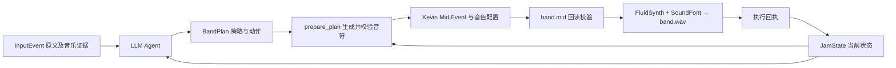

# BandPlan 接入 Kevin Renderer（2026-10-31）

已接通 **InputEvent → LLM Agent → BandPlan → Kevin MIDI → FluidSynth WAV → 执行回执 → JamState**。目前是离线导出闭环，实际运行了 SoundFont 合成；回执不代表声卡已经播放。

实现位于 [band_plan.py](../renderer_experiments/app/band_plan.py)，复用 Kevin 原有的 MIDI 文件导出、音色预设和 FluidSynth 调用。新入口从完整 repository 运行；`renderer_experiments` 仍是仓库内实验模块，没有打包进 `jammate` wheel。

## 1. 上下游各做什么



- **Wyman / Agent**：结合输入和历史作决策，绑定状态版本、下一小节、保留约束和动作；接收回执后维护唯一音乐状态。
- **上游输入**：提交文字原文、分析得到的节奏、Basic Pitch 导出的旋律 JSON。哼唱里的 seconds 按当前 session BPM 转成 beats，不把 MIDI referenceBpm 当成会话速度。
- **Kevin / 执行端**：校验当前计划，获得具体音符，映射 MIDI channel/program，导出 MIDI，合成音频并报告结果。

现在具体音符仍由已有 `prepare_plan()` / 小节编排器生成。Kevin 的 `MusicIntent` 默认 BPM、和弦及 `render_pattern()` 不参与这条路径，避免重新生成音符破坏用户要求的节奏、旋律或保留约束。以后替换音符生成器，公共 InputEvent/JamState/BandPlan 可以继续使用。

## 2. 时间与正确性

`prepare_plan` 输出绝对会话拍数。导出某段时：

```text
localSeconds = (absoluteBeat - effectiveBar * 4) * 60 / sessionBpm
```

每段 MIDI 的拍零对应 `effective_at.bar`；段内保留旋律开头的休止、音高、力度和音符时长。MIDI 文件中的 tempo 来自实际执行的 JamState，段末写入完整小节时长，保留尾部休止。

此次修复了两个 MIDI 导出问题：

1. 先把每个绝对时间转成 tick，再求相邻 tick 差，避免对每段 delta 分别四舍五入后累积漂移。回读误差上限为半个 MIDI tick。
2. 同一 tick 的 note-off 先于 note-on，避免相邻同音高音符的小数取整误差导致新音刚开始就被前一音的 note-off 截断。`all_notes_off` 也会真正写成 CC123。

不同音高的重叠可正常保留。同一 channel、同音高、跨越实际 MIDI tick 的重叠声部目前拒绝执行，不能声称普通单通道 MIDI 能独立表达这些声部；微秒级舍入导致的同 tick 相邻音已处理。

导出后实际回读 MIDI，核对事件类型、音高、channel、velocity、program、时间误差和总时长；WAV 检查采样率、时长、有限样本及非空计划是否被错误渲染成静音。最后才向 StateManager 提交成功回执。过期/被新输入取消的计划即使导出完，也不能更新状态。

状态与日志依然是进程内协议，不是跨进程事务或自动恢复机制。文件写入错误需要结合 `plan_status`、trace 和产物检查，不能根据一个文件名推断已经提交成功。

诊断迭代后：必须检查 `acknowledge()` 是否接受回执，不能把 False 当成功。执行失败保留 `manager.current_batch()`，调用方可显式使用新 plan_id 重规划；新输入会覆盖这批待处理输入。不要用重复发送旧 event_id 来模拟重试。

JSON 文件使用临时文件原子替换。状态提交后若诊断文件写入失败，Runtime 通过 `last_receipt.persistence_warnings` 报告，保持真实的 succeeded 值；`manager.diagnostics()` 单独报告日志错误。示例报告已展示这些 warning。当前没有重启恢复保证，见 [多轮诊断](DIAGNOSTIC_ITERATION_20261031.md)。

## 3. 如何调整乐器

默认 `electric` profile，主旋律默认长笛：

| 声部 | 代码 channel（从 0 开始） | DAW 常见通道编号 | 默认 program（从 0 开始） | 音色 |
|---|---:|---:|---:|---|
| drums | 9 | 10 | GM 鼓组 | 鼓音由 pitch 选择 |
| bass | 2 | 3 | 33 | Fingered Bass |
| keys | 1 | 2 | 4 | Electric Piano 1 |
| lead | 4 | 5 | 73 | Flute |

`--instrument-profile acoustic` 将键盘换成钢琴；`synth` 使用 Pad / Synth Bass。`--lead-program 80` 可将主旋律改为 GM Lead 1；参数范围 0–127。SoundFont 决定具体音色，同一个 MIDI 在不同 SoundFont 上听感会不同。

这些是执行端配置。当前 LLM 的 BandPlan 动作还不包含音色切换；自然语言要求“换管风琴”会记录为 unresolved，而不是假装切换成功。扩展时应先增加受控的 renderer 能力/参数，再对外开放。

## 4. 本机直接运行

在仓库根目录、Windows `jammate` Python 环境中：

```bat
python examples/agent_demo.py --renderer kevin ^
  --fluidsynth "%USERPROFILE%\.local\share\jammate\renderer\fluidsynth\fluidsynth-v2.6.1-win10-x64-cpp11\bin\fluidsynth.exe" ^
  --soundfont "%USERPROFILE%\.local\share\jammate\renderer\soundfont\usr\share\sounds\sf2\TimGM6mb.sf2" ^
  --instrument-profile electric --lead-program 73 ^
  --text "鼓更有力，其他不变" ^
  --text "只让键盘少弹一些，速度不变"
```

API 配置沿用 [LLM_AGENT.md](LLM_AGENT.md)，不需要再次放入代码。去掉 `--renderer kevin` 则仍使用原有 numpy 参考音色。需要不调用 API 的执行演示可加 `--agent rule`。

本机外部资源已放在 `%USERPROFILE%\.local\share\jammate\renderer\`，不提交仓库：

- FluidSynth 2.6.1，来自 [官方 release](https://github.com/FluidSynth/fluidsynth/releases/tag/v2.6.1)。下载包 SHA256 存在本机 `sources.json`。
- TimGM6mb，来自 [Ubuntu timgm6mb-soundfont 1.3-5](https://packages.ubuntu.com/jammy/timgm6mb-soundfont)，包内版权文件随资源保留。每份执行回执记录 `.sf2` 的 SHA256。

其他机器自行指定对应的 executable / `.sf2` 路径。缺少依赖会明确失败，不会悄悄用参考合成器冒充 FluidSynth。

## 5. 看哪些文件

```text
demo_out/agent_llm/<时间>/
  band.wav                       # 逐段音频按小节拼接，保留释放尾音
  report.json
  turn_01/
    input_01.json
    state_observed.json
    agent_decision.json
    plan.json
    band.mid / band.wav
    receipt.json
    state_applied.json
  renderer/plan_<安全哈希>/
    events.json                  # Kevin MidiEvent，时间单位秒
    band.mid / band.wav
    render_result.json           # 提交回执之前的导出证据
    receipt.json                 # 包含状态版本、生效范围、MIDI/WAV 校验
```

Kevin 模式以每轮 MIDI 为准，不再用旧导出器生成合并 MIDI，避免丢掉 program 或变速时间信息。整段 WAV 仍会提供；单轮回执中的峰值对应原始单轮文件，拼接版必要时统一降低增益。

## 6. 还需推进的实时工作

1. 将模型调用放到音频回调之外，使用共享 transport 提供 lookahead 与生效小节。
2. 接通真实播放队列，处理新输入覆盖、紧急停止、音符释放和播放回执。
3. 对接输入完成/用户活动信号；测真实声卡延迟与跨小节连续性。
4. 另行验证 Lyria 等语义音频后端。它们不能沿用“逐音符精确保留”的 MIDI 保证。

本次没有改用 Kevin 原实验的 `MidiRenderer.update()` 来实时执行新计划，因为它会 stop/start 并重启时钟。当前回执里的 bar 是离线逻辑位置，不是已完成的现场共享时钟联调。

新输入批次的结果、失败案例和修复记录见 [ACCEPTANCE_20261031.md](ACCEPTANCE_20261031.md)。
