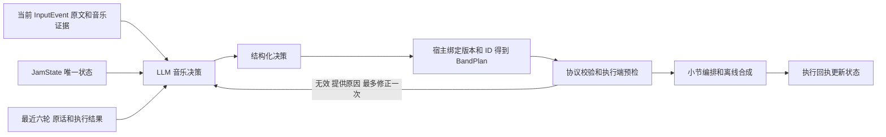

# LLM Agent：由模型承担音乐决策

2026-10-31：**新 Agent 演示入口已默认使用 LLM**。实际连接 OpenAI 官方 API，当前本机配置为 `gpt-5.4-mini`、`reasoning_effort=low`。规则 Agent 保留作离线基线和可选 fallback；正常 LLM 路径不先跑关键词解析器。

## 1. 直接使用

本机已在 Windows conda `jammate` 环境安装 OpenAI SDK，并从用户指定文档配置凭据。进入项目根目录即可运行：

```bat
python examples/agent_demo.py --scenario expressive
```

这会真实调用 API，执行八轮包含自然表达、指代和历史恢复的开发场景，输出到 `demo_out/agent_llm/<时间>/`。不用麦克风，不会自动通过声卡播放。

自己输入多轮话语：

```bat
python examples/agent_demo.py --text "别加速，只让鼓更有冲击力，贝斯和和弦照旧" --text "把刚才加强的那个声部调回最开始的力度"
```

也可继续使用 `--batch <InputEvent文件...>`，重复 --batch 表示多轮；同一个 batch 表示上游明确关联的一轮。`--text` 与 `--batch` 互斥。仍未实现自动关联同时到达的多模态输入。

不调用 API 的旧基线：

```bat
python examples/agent_demo.py --agent rule
```

跨机器安装依赖：`pip install -e ".[llm]"`；完整开发环境也可安装 `requirements.txt`。原来的 `python -m jammate live/offline/rhythm` 仍是旧路径，没有随本轮一起迁移为 LLM 入口。

## 2. LLM 具体负责什么



LLM 直接选择策略、动作组合、声部、力度/密度变化、持续小节、保留约束和说明。它能结合历史理解“刚才拿掉的那个声部”“退回最开始的水平”，不局限于把句子归入旧的 KEEP/BUILD 等关键词标签。

模型输入包含当前事件、当前状态和最多六轮历史。历史分别记录计划 pending/applied/failed/cancelled/expired，以及成功执行前后的状态；失败的建议不会被描述成已经执行。当前事件放在上下文最后，并明确区分历史 last_feedback，防止空闲时重复执行上一句要求。

哼唱向模型提供所选音符、时间基准、状态和对应 motif ID；原始 InputEvent 仍完整留在本地。不会自动打开 provenance 中的音频路径、上传整个 Word 文档或把 API key 放入上下文。输入音频识别仍由输入组负责。

结构化输出采用 OpenAI 的 JSON Schema 模式；具体 API 格式依据 [Structured Outputs 官方文档](https://developers.openai.com/api/docs/guides/structured-outputs)。内部输出结构只是模型到 BandPlan 的适配表示，不新增一套对外共享音乐状态。

## 3. 为什么仍然保留一些确定性代码

| 部分 | 当前负责者 |
|---|---|
| 自由文本理解、结合历史判断、音乐策略与动作 | LLM |
| session/event/plan ID、状态版本、生效小节 | 宿主程序绑定，模型不能伪造 |
| 动作参数和已登记 motif/rhythm 引用是否合法 | schema 与语义校验 |
| “保留贝斯/节奏”是否真的保持实际音符 | Renderer 的无音频预检 |
| 重复事件、迟到计划、执行成功才提交状态 | StateManager |
| 具体音符、合成音色、WAV/MIDI | 现有规则编排和合成器 |

这些执行约束不重新解析用户话语。它们检查模型提议能否兑现。例如“只加强鼓但保留贝斯”，若模型附带了一个会改变贝斯拍点的节奏切换，会在提交前拒绝并把原因反馈给模型。

每种动作只允许它自己的参数；preserve、motif/rhythm 引用还按当前状态限制取值。模型只能选择现有能力：不能凭一句话增加吉他、改变音色或把某个字段写入当作实际完成。尚未支持的要求必须在 unresolved 中说明。

目前 LLM 是 **Agent 决策骨干**；音符生成仍由现有编排器负责。Kevin 的 MIDI / FluidSynth 后端已接入相同的 JamState + BandPlan，并提供预检和执行回执，不需要再写一套自然语言意图解析。见 [KEVIN_RENDERER.md](KEVIN_RENDERER.md)。

## 4. 配置与失败行为

本机私有配置位置：`C:\Users\31237\.config\jammate\openai.json`。它在 Git 仓库外；原 Word 文档未修改。配置结构如下，示例不包含实际密钥：

```json
{
  "api_key": "<your key>",
  "base_url": "https://api.openai.com/v1",
  "model": "gpt-5.4-mini",
  "api": "responses",
  "reasoning_effort": "low",
  "timeout_s": 20,
  "max_output_tokens": 2400
}
```

其他机器可通过 `--config <私有配置路径>` 或 `JAMMATE_LLM_CONFIG` 指定。也支持 OPENAI_API_KEY、OPENAI_BASE_URL、JAMMATE_LLM_MODEL、JAMMATE_LLM_API、JAMMATE_LLM_REASONING_EFFORT 环境变量。设置环境变量 API key 会采用独立的 provider 配置，避免把新的 key 发到私有文件遗留的另一家 endpoint；未另设 base_url 时使用 OpenAI 官方地址。

`--model`、`--reasoning-effort` 可覆盖当前配置。`--reasoning-effort default` 表示不发送 effort 参数，适用于不支持该参数的模型；不会自动猜测或切换模型。`api=chat_completions` 有兼容实现和模拟 HTTP 测试，本轮真实 API 验证走 Responses。未实现自动退回 JSON mode 或切换 provider。

默认请求超时 20 秒，SDK 自动重试关闭；验证失败最多让模型修正一次，修正调用使用剩余预算。这个设置不是硬实时期限保证。认证失败、限流、拒答、连接错误或截断输出直接进入 fallback，不盲目重试。

默认 `--fallback hold`：保持当前伴奏，记录 unresolved 和失败类别。可选 `--fallback rule` 调用旧规则基线并再次预检，或 `--fallback error` 在评测中明确失败。日志区分 `llm`、`fallback`、`rule`、`system_control`，不会把 fallback 统计成模型成功。

Runtime 发来的 system/stop 是明确控制信号，立即生成停止计划，不等待网络；自然语言“不要停”等仍由模型理解。新输入/时钟推进后，旧模型结果仍会被 StateManager 拒绝；不会为了执行迟到结果偷偷改写 based_on_state_version。

## 5. 如何检查结果

每轮仍有 InputEvent、plan.json、state_observed.json、state_applied.json、band.wav/.mid；新增 `agent_decision.json`，记录模型、来源、耗时、token 用量、尝试次数和校验失败原因。配置输出不包含 key，API 错误只保留类别/状态码，不保存可能带凭据的错误正文。

`trace.jsonl` 将 agent_decision 与原有观察、计划、执行回执关联。请同时看 plan、执行后状态和音符结果，不能只看模型解释。

开发场景可独立复核，无需再次调用 API：

```bat
python examples/evaluate_agent_demo.py demo_out/agent_llm/gpt54mini_low_20261031
```

LLM 接入阶段的历史记录（后续批次与最新测试见 [ACCEPTANCE_20261031.md](ACCEPTANCE_20261031.md)）：

- **根测试 368 passed，5 个已有警告**；新增 LLM 测试 44 项，普通 pytest 使用模拟 provider/HTTP，不真实调用 API。
- `gpt-5.4-mini` + low，8 轮均为 LLM 决策，8 个开发场景通过；0 次修正、0 次 fallback。
- 场景涵盖节奏+哼唱、只加强鼓、鼓点减少但力度不变、按历史恢复初始力度、主动一句、再次空闲等待、移除贝斯、通过指代恢复贝斯。
- 决策耗时 1.922–4.281 秒，中位数 2.196 秒；8 次调用累计 input_tokens=73,251、output_tokens=2,276（按 API 返回的 usage 记录）。
- 音频 73.5 秒，MIDI 676 个音符；第三轮音符数从 96 降到 88，鼓 level 保持不变。
- 产物在本机 `demo_out/agent_llm/gpt54mini_low_20261031/`，不提交生成音频和会话文件。

调试早期曾出现多模态计划保留约束冲突、旧反馈重复执行和轻微简化未减少音符。早期产物保留在相邻目录；其中 `gpt54mini_v2_20261031/evaluation.json` 是 **6/8**，不能当作最终通过记录。后续补充执行预检、完整约束反馈、当前事件定位，并修正稀疏音符密度取整。模型/prompt/执行器随调试变化，这些记录不能直接用作模型间公平比较。

最终 8/8 也是调试过的单次开发样例，**不是盲测准确率，也不保证任意表达都正确**。模型解释仍可能出错，结构化输出只约束结构；听感、真人识别质量、长会话泛化与实时延迟都需要另验。

## 6. 下一步

2026-10-31 诊断更新：模型现在读取完整 JamState 的有限视图，优先保留当前/活跃、明确 ID 引用及最近的材料；schema 与可见 ID 一致。预算包含系统提示、schema 和修正消息。当前输入超预算会明确降级，不截掉原文或旋律；旧材料仍在共享状态中。300 轮故障测试、真实 26 轮结果及边界见 [诊断报告](DIAGNOSTIC_ITERATION_20261031.md)，具体推进顺序见 [完善计划](PROJECT_IMPROVEMENT_PLAN.md)。

新文字/合成 WAV 批次及 Kevin 离线回执已验证；四段合成哼唱暴露了长音过度切分问题，不能用导出成功代替识别质量，详见 [批次报告](ACCEPTANCE_20261031.md)。下一步需要真人录音、上游活动信号和真实播放联调。播放端需要异步决策、足够的 lookahead、过期丢弃和播放中断协议；目前 `LLMAgent`/演示按单会话串行调用，不能把这段同步 API 调用直接塞进音频回调。

代码入口：[llm.py](../src/jammate/orchestration/llm.py)、[提示词](../src/jammate/orchestration/llm_prompt.md)、[模型输出 schema](../src/jammate/orchestration/llm_decision.schema.json)、[配置](../src/jammate/orchestration/llm_config.py)、[测试](../tests/test_llm_agent.py)。
